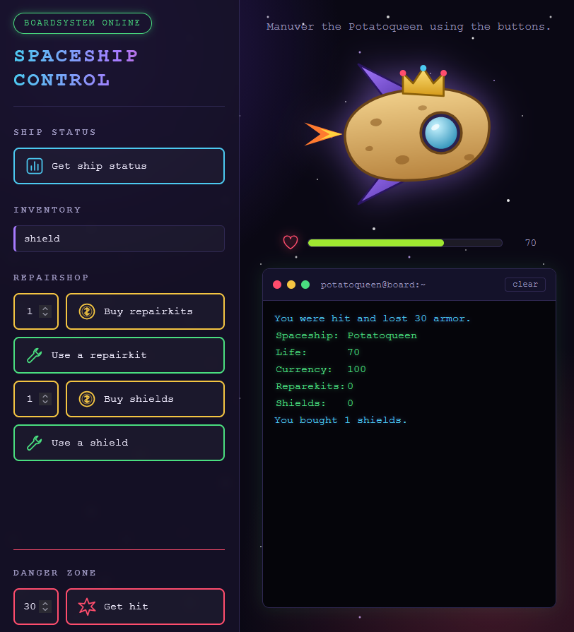

# Spaceship Control

A small browser game about the spaceship **Potatoqueen**.

This is a practice project from my retraining (*Umschulung*) at the **Developer Akademie**. It grows alongside the course, so it is a learning project and not a finished product.



## What it does

- Buy repairkits and shields with your currency
- Use a repairkit to restore life, or a shield to halve the damage of the next hit
- Take hits of any size and watch the life bar drain
- Game over when life reaches 0, then start again

## Built with

- HTML
- CSS (BEM naming, custom properties)
- Vanilla JavaScript, no frameworks

## Project structure

```
spaceship/
├── index.html
├── css/
│   └── style.css
├── js/
│   ├── game.js          # game state, messages, restart, game over
│   └── ship-logic.js    # shop, inventory, hits, life bar
└── assets/
    └── img/             # ship, icons, background, screenshot
```

## Run it

No build step needed. Open `index.html` in a browser, or use a local server such as the VS Code *Live Server* extension.